<!-- Profile README v3 · "AGENT_OS" · every animation is a hand-written SVG in /assets (no JS). Cards in /assets/generated are rebuilt daily by .github/workflows/profile-stats.yml -->

<a href="https://selvinpaulraj.vercel.app"><picture><source media="(prefers-color-scheme: dark)" srcset="assets/hero-dark.svg"><source media="(prefers-color-scheme: light)" srcset="assets/hero-light.svg"></picture></a>

  
  
  
  
  
  

<b>AI Engineer building agentic AI and LLM apps.</b> I turn messy, real-world workflows into agents that are grounded, tested and safe to ship. 
Open to AI / LLM / agentic engineer roles · Chennai, India · <a href="#feeds">#AIEngineerIn150Days</a>

  
  
  
  
  
  
  

<picture><source media="(prefers-color-scheme: dark)" srcset="assets/divider-dark.svg"><source media="(prefers-color-scheme: light)" srcset="assets/divider-light.svg"></picture>

<picture><source media="(prefers-color-scheme: dark)" srcset="assets/h-whoami-dark.svg"><source media="(prefers-color-scheme: light)" srcset="assets/h-whoami-light.svg"></picture>

<picture><source media="(prefers-color-scheme: dark)" srcset="assets/terminal-dark.svg"><source media="(prefers-color-scheme: light)" srcset="assets/terminal-light.svg"></picture>

<b>🎓 Education, certifications and awards</b> (click to expand)

 

- **M.E. CSE (AI)**, Kings Engineering College (2025 to now) · **B.Tech IT**, DMI College of Engineering (2021 to 2025, CGPA 8.4)
- Claude Certified Architect, Foundations (Anthropic)
- Model Context Protocol: Advanced Topics (Anthropic)
- Hugging Face Agents Course (Hugging Face)
- ACP: Agent Communication Protocol, and Agentic Knowledge Graph Construction (DeepLearning.AI)
- Machine Learning with Python (IBM)
- 🥇 1st, National Hackathon (Alpha College of Engineering) · 🥉 3rd, SheInnovates Hackathon (Women Techmakers Chennai) · 2nd, National Coding Contest (Chennai Institute of Technology)

<picture><source media="(prefers-color-scheme: dark)" srcset="assets/h-building-dark.svg"><source media="(prefers-color-scheme: light)" srcset="assets/h-building-light.svg"></picture>

<a href="https://ai-with-spr.vercel.app"><picture><source media="(prefers-color-scheme: dark)" srcset="assets/generated/building-dark.svg"><source media="(prefers-color-scheme: light)" srcset="assets/generated/building-light.svg"></picture></a>

<picture><source media="(prefers-color-scheme: dark)" srcset="assets/h-work-dark.svg"><source media="(prefers-color-scheme: light)" srcset="assets/h-work-light.svg"></picture>

**At Zinnov (Draup)** · Associate Data Analyst, AI Automation · Sep 2025 to now (Tech Intern, Jun to Sep 2025)

| | Agent | Impact |
|:-:|---|---|
| 🕸️ | **LangGraph multi-agent system** that turns plain-English data requests into validated queries and Excel reports | analyst turnaround from **hours to under a minute** |
| 🔎 | **Hybrid retrieval (FAISS + BM25)** plus an entity-resolution agent with human-in-the-loop checks | **2.6M** company records · **2.4M+** companies and subsidiaries · sub-second lookups |
| 📡 | **Business-signal monitoring agent**: scraping, de-duplication, LLM classification, scoring and automated reports | **537** enterprise accounts across **8** industries |

<picture><source media="(prefers-color-scheme: dark)" srcset="assets/h-projects-dark.svg"><source media="(prefers-color-scheme: light)" srcset="assets/h-projects-light.svg"></picture>

<table>
<tr>
<td width="50%"><a href="https://github.com/selvin-paul-raj/Finn-Advisor"><picture><source media="(prefers-color-scheme: dark)" srcset="assets/generated/project-finn-advisor-dark.svg"><source media="(prefers-color-scheme: light)" srcset="assets/generated/project-finn-advisor-light.svg"></picture></a></td>
<td width="50%"><a href="https://github.com/selvin-paul-raj/chunklab"><picture><source media="(prefers-color-scheme: dark)" srcset="assets/generated/project-chunklab-dark.svg"><source media="(prefers-color-scheme: light)" srcset="assets/generated/project-chunklab-light.svg"></picture></a></td>
</tr>
<tr>
<td width="50%"><a href="https://github.com/selvin-paul-raj/Linkedin-Alpic-Mcp"><picture><source media="(prefers-color-scheme: dark)" srcset="assets/generated/project-linkedin-alpic-mcp-dark.svg"><source media="(prefers-color-scheme: light)" srcset="assets/generated/project-linkedin-alpic-mcp-light.svg"></picture></a></td>
<td width="50%"><a href="https://github.com/selvin-paul-raj/Instagram-Alpic-mcp"><picture><source media="(prefers-color-scheme: dark)" srcset="assets/generated/project-instagram-alpic-mcp-dark.svg"><source media="(prefers-color-scheme: light)" srcset="assets/generated/project-instagram-alpic-mcp-light.svg"></picture></a></td>
</tr>
<tr>
<td width="50%"><a href="https://github.com/selvin-paul-raj/outlook-cli"><picture><source media="(prefers-color-scheme: dark)" srcset="assets/generated/project-outlook-cli-dark.svg"><source media="(prefers-color-scheme: light)" srcset="assets/generated/project-outlook-cli-light.svg"></picture></a></td>
<td width="50%"><a href="https://github.com/selvin-paul-raj/Linkedin-MCP-Server"><picture><source media="(prefers-color-scheme: dark)" srcset="assets/generated/project-linkedin-mcp-server-dark.svg"><source media="(prefers-color-scheme: light)" srcset="assets/generated/project-linkedin-mcp-server-light.svg"></picture></a></td>
</tr>
<tr>
<td width="50%"><a href="https://github.com/selvin-paul-raj/ChatDex-AI"><picture><source media="(prefers-color-scheme: dark)" srcset="assets/generated/project-chatdex-ai-dark.svg"><source media="(prefers-color-scheme: light)" srcset="assets/generated/project-chatdex-ai-light.svg"></picture></a></td>
<td width="50%"><a href="https://github.com/selvin-paul-raj/daily-ai-digest"><picture><source media="(prefers-color-scheme: dark)" srcset="assets/generated/project-daily-ai-digest-dark.svg"><source media="(prefers-color-scheme: light)" srcset="assets/generated/project-daily-ai-digest-light.svg"></picture></a></td>
</tr>
</table>

Live demo: <a href="https://chunklab-spr.streamlit.app/">ChunkLab on Streamlit</a> · Package: <a href="https://www.npmjs.com/package/outlook-cli">outlook-cli on npm</a> · <a href="https://github.com/selvin-paul-raj?tab=repositories">All repositories →</a>

<picture><source media="(prefers-color-scheme: dark)" srcset="assets/h-stack-dark.svg"><source media="(prefers-color-scheme: light)" srcset="assets/h-stack-light.svg"></picture>

<picture><source media="(prefers-color-scheme: dark)" srcset="assets/orbit-dark.svg"><source media="(prefers-color-scheme: light)" srcset="assets/orbit-light.svg"></picture>

<b>🧰 Full toolbox</b> (click to expand)

 

<picture>
  <source media="(prefers-color-scheme: dark)" srcset="https://skillicons.dev/icons?i=python,fastapi,postgres,sqlite,docker,aws,githubactions,git,linux,ts,nextjs,react,tailwind,nodejs,pytorch,sklearn,vercel&theme=dark&perline=9">
  <source media="(prefers-color-scheme: light)" srcset="https://skillicons.dev/icons?i=python,fastapi,postgres,sqlite,docker,aws,githubactions,git,linux,ts,nextjs,react,tailwind,nodejs,pytorch,sklearn,vercel&theme=light&perline=9">
  
</picture>

<picture><source media="(prefers-color-scheme: dark)" srcset="assets/h-telemetry-dark.svg"><source media="(prefers-color-scheme: light)" srcset="assets/h-telemetry-light.svg"></picture>

<picture><source media="(prefers-color-scheme: dark)" srcset="assets/generated/stats-dark.svg"><source media="(prefers-color-scheme: light)" srcset="assets/generated/stats-light.svg"></picture>
<picture><source media="(prefers-color-scheme: dark)" srcset="assets/generated/langs-dark.svg"><source media="(prefers-color-scheme: light)" srcset="assets/generated/langs-light.svg"></picture>

<picture><source media="(prefers-color-scheme: dark)" srcset="assets/generated/pulse-dark.svg"><source media="(prefers-color-scheme: light)" srcset="assets/generated/pulse-light.svg"></picture>

<b>📈 More live cards</b> (third-party services; may be slow)

 

  <picture>
    <source media="(prefers-color-scheme: dark)" srcset="https://github-readme-stats.vercel.app/api?username=selvin-paul-raj&show_icons=true&hide_border=true&rank_icon=github&border_radius=12&bg_color=0b1328&title_color=22d3ee&icon_color=a78bfa&text_color=e6f1ff&ring_color=22d3ee">
    <source media="(prefers-color-scheme: light)" srcset="https://github-readme-stats.vercel.app/api?username=selvin-paul-raj&show_icons=true&hide_border=true&rank_icon=github&border_radius=12&bg_color=f8fafc&title_color=0e7490&icon_color=6d28d9&text_color=0b1220&ring_color=0e7490">
    
  </picture>
  <picture>
    <source media="(prefers-color-scheme: dark)" srcset="https://streak-stats.demolab.com?user=selvin-paul-raj&hide_border=true&border_radius=12&background=0B1328&ring=22D3EE&fire=A78BFA&currStreakLabel=22D3EE&sideLabels=E6F1FF&currStreakNum=E6F1FF&sideNums=E6F1FF&dates=A9BBD6&stroke=22335A">
    <source media="(prefers-color-scheme: light)" srcset="https://streak-stats.demolab.com?user=selvin-paul-raj&hide_border=true&border_radius=12&background=F8FAFC&ring=0E7490&fire=6D28D9&currStreakLabel=0E7490&sideLabels=0B1220&currStreakNum=0B1220&sideNums=0B1220&dates=475569&stroke=C8D4E8">
    
  </picture>

If a card above is blank, the service is down. The cards in the Telemetry section are self-hosted and always load. Fallback: <a href="https://github-profile-summary-cards.vercel.app/api/cards/stats?username=selvin-paul-raj&theme=github_dark">profile summary card</a>.

<!-- METRICS (optional): enable .github/workflows/metrics.yml first (see that file), then remove this comment wrapper.

-->

<!-- WAKATIME (optional): enable .github/workflows/wakatime.yml (see that file), then put the two waka-readme markers (START_SECTION:waka and END_SECTION:waka, each wrapped in an HTML comment) on their own lines right here. -->

<picture><source media="(prefers-color-scheme: dark)" srcset="assets/h-arcade-dark.svg"><source media="(prefers-color-scheme: light)" srcset="assets/h-arcade-light.svg"></picture>

<picture><source media="(prefers-color-scheme: dark)" srcset="https://raw.githubusercontent.com/selvin-paul-raj/selvin-paul-raj/output/snake-dark.svg"><source media="(prefers-color-scheme: light)" srcset="https://raw.githubusercontent.com/selvin-paul-raj/selvin-paul-raj/output/snake-light.svg"></picture>

<b>👾 Pac-Man mode</b>

 

<picture><source media="(prefers-color-scheme: dark)" srcset="https://raw.githubusercontent.com/selvin-paul-raj/selvin-paul-raj/output/pacman-contribution-graph-dark.svg"><source media="(prefers-color-scheme: light)" srcset="https://raw.githubusercontent.com/selvin-paul-raj/selvin-paul-raj/output/pacman-contribution-graph.svg"></picture>

<b>🏙️ 3D contribution city</b>

 

<picture><source media="(prefers-color-scheme: dark)" srcset="https://raw.githubusercontent.com/selvin-paul-raj/selvin-paul-raj/output/profile-3d-contrib/profile-night-rainbow.svg"><source media="(prefers-color-scheme: light)" srcset="https://raw.githubusercontent.com/selvin-paul-raj/selvin-paul-raj/output/profile-3d-contrib/profile-gitblock.svg"></picture>

<picture><source media="(prefers-color-scheme: dark)" srcset="assets/h-feeds-dark.svg"><source media="(prefers-color-scheme: light)" srcset="assets/h-feeds-light.svg"></picture>

<table>
<tr>
<td width="50%" valign="top">

**✍️ From the blog** · [ai-with-spr.vercel.app](https://ai-with-spr.vercel.app)

<!-- BLOG-POST-LIST:START -->
- [Day 15: Tool calling done right, schemas, validation and retries](https://ai-with-spr.vercel.app/blog/day-15-tool-calling-done-right-schemas-validation-retries) · Oct 24, 2026
- [Day 14: SQL for AI engineers, windows, CTEs and DuckDB on one page](https://ai-with-spr.vercel.app/blog/day-14-sql-for-ai-engineers-windows-ctes-and-duckdb) · Oct 23, 2026
- [LiteLLM 1.107.0, explained: how a leaked token in gateway logs became a poisoned release](https://ai-with-spr.vercel.app/blog/litellm-1-107-0-supply-chain-attack-deep-dive) · Oct 23, 2026
- [Day 13: From hours to under a minute, what a plain-English-to-report pipeline really needs](https://ai-with-spr.vercel.app/blog/day-13-hours-to-under-a-minute-text-to-sql-agent-pipeline) · Oct 22, 2026
- [Day 12: Supervisor multi-agent vs a single agent, calls, tokens and wall time](https://ai-with-spr.vercel.app/blog/day-12-supervisor-vs-single-agent-calls-tokens-wall-time) · Oct 21, 2026

<!-- BLOG-POST-LIST:END -->

</td>
<td width="50%" valign="top">

**▶️ On YouTube** · [@aiwithspr](https://www.youtube.com/@aiwithspr)

<!-- YOUTUBE-VIDEO-LIST:START -->
- [4 new MCP servers worth a look #shorts](https://www.youtube.com/shorts/XtwcFVTao2Y) · Oct 21, 2026
- [Free 3B-active memory model for agents #shorts](https://www.youtube.com/shorts/5Go1BU4Y6Hs) · Oct 19, 2026
- [Day 8/150: A safe SQL agent #shorts](https://www.youtube.com/shorts/iMC676popK4) · Oct 18, 2026
- [Is a $0.20 coding agent good enough? #shorts](https://www.youtube.com/shorts/3vsr12mwPc0) · Oct 18, 2026
- [Day 7/150: Agents that remember #shorts](https://www.youtube.com/shorts/UZihRRHX3wc) · Oct 17, 2026

<!-- YOUTUBE-VIDEO-LIST:END -->

</td>
</tr>
</table>

<b>#AIEngineerIn150Days</b>: a public, day-by-day path to AI engineering. A post on <a href="https://www.linkedin.com/in/selvinpaulraj">LinkedIn</a>, a deep write-up on the <a href="https://ai-with-spr.vercel.app">blog</a> and a Short on <a href="https://www.youtube.com/@aiwithspr">YouTube</a>. Both lists refresh daily from RSS.

<picture><source media="(prefers-color-scheme: dark)" srcset="assets/h-connect-dark.svg"><source media="(prefers-color-scheme: light)" srcset="assets/h-connect-light.svg"></picture>

<a href="https://selvinpaulraj.vercel.app"><picture><source media="(prefers-color-scheme: dark)" srcset="assets/ask-agent-dark.svg"><source media="(prefers-color-scheme: light)" srcset="assets/ask-agent-light.svg"></picture></a>

Building agents, RAG systems or MCP tools, or hiring for an AI / LLM / agentic engineer role? Let's talk.

  
  
  
  
  
  

<picture><source media="(prefers-color-scheme: dark)" srcset="assets/footer-dark.svg"><source media="(prefers-color-scheme: light)" srcset="assets/footer-light.svg"></picture>

